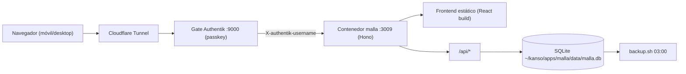

# Plan — Malla curricular interactiva (`malla.kansostudio.dev`)

App web responsive y mobile first que muestra toda la malla curricular como un árbol de nodos. Cada materia es una caja. Las materias se van desbloqueando a medida que se completan sus requisitos. Incluye indicadores de progreso y una estimación de la fecha de graduación. El progreso persiste en el servidor Kanso, así que se ve igual desde cualquier navegador o dispositivo.

---

## 1. Decisiones tomadas (resumen de la entrevista)

| # | Tema | Decisión |
|---|------|----------|
| 1 | Origen de la malla | Bryan adjunta la malla (PDF/imagen) → se convierte a `curriculum.json` fijo dentro del repo |
| 2 | Usuarios | Un solo usuario (Bryan), una sola malla |
| 3 | Persistencia | **Self-hosted en Kanso**: SQLite en `data/` dentro de un contenedor propio. Costo $0, entra en el backup de las 03:00 |
| 4 | Login | Gate de **Authentik** existente (passkey). Sin sesión no se ve nada (el gate redirige a `auth.kansostudio.dev`). El usuario llega en la cabecera `X-authentik-username` |
| 5 | Estados | 4 estados: **Bloqueada → Disponible → Cursando → Completada** |
| 6 | Tipo de requisitos | Solo prerrequisitos simples (AND): se desbloquea cuando **todos** los requisitos están completados |
| 7 | Desmarcar | Solo se puede regresar una materia (Completada/Cursando → Disponible, o Completada → Cursando) si **ninguna dependiente** está Cursando o Completada |
| 8 | Gestos | **1 tap** = resaltar ruta · **doble tap** (desktop y móvil) o **mantener presionado** (móvil) = abrir mini menú de estado |
| 9 | Cambio de estado | Mini menú (popover) junto al nodo con opciones directas: Disponible / Cursando / Completada |
| 10 | Resaltado | Dim de todo lo demás + resaltar **todos los prerrequisitos recursivos** (ruta hacia arriba) + **dependientes directos** (hacia abajo), con colores distintos |
| 11 | Layout | Por **niveles de dependencia**: fila 1 = sin requisitos; fila N = 1 + nivel máximo de sus requisitos |
| 12 | Navegación | Lienzo con pan y pinch-zoom + botones "centrar" y "ajustar a pantalla" |
| 13 | Contenido del nodo | Solo el **nombre**, coloreado según su estado |
| 14 | Indicadores | % de materias completadas + contadores (completadas / cursando / disponibles / bloqueadas) |
| 15 | Estimación | **Simulación** periodo por periodo que respeta requisitos y la ruta crítica → "N cuatrimestres → fecha aprox." |
| 16 | Parámetros | Cuatrimestral (3 por año), **4 materias por cuatrimestre por defecto (configurable)**. Se recalcula en vivo con lo que falte |
| 17 | Suficiencias | No hay trato especial: una materia aprobada por suficiencia es simplemente una materia Completada |
| 18 | Calendario | Cuatrimestres fijos: **Ene–Abr, May–Ago, Sep–Dic**. Las materias "Cursando" terminan al final del cuatrimestre actual |
| 19 | Stack | React + Vite + TypeScript + React Flow (`@xyflow/react`) + Tailwind CSS · Backend: Node + Hono + SQLite (`better-sqlite3`) |
| 20 | Tema | Oscuro por defecto con interruptor claro/oscuro. Colores: bloqueada gris, disponible azul, cursando ámbar, completada verde |
| 21 | Offline/PWA | **No**. Solo funciona en línea |
| 22 | Extras v1 | Filtro "solo disponibles" / "ocultar completadas" (atenúa fuertemente, **no** recalcula el layout) |
| 23 | Sincronización | Guardado inmediato con actualización optimista; recarga el estado del servidor al abrir la app o volver a la pestaña. Sin tiempo real |
| 24 | Optativas | Bloques "elige N de una lista" → una caja `Optativas X (k/N)`; doble tap / mantener presionado abre un panel inferior con la lista de opciones |
| 25 | Deploy | Repo privado `bryanmongesolano/degree-progress` (`main`) → GitHub Actions ARM → GHCR privado → SSH a la VM. Subdominio **`malla.kansostudio.dev`** |

---

## 2. Arquitectura



- **Un solo contenedor**: Hono sirve el frontend compilado (`dist/`) y la API `/api/*`. El "cliente" (frontend) y el "servidor" (API) viven en el mismo origen, así que no hay problemas de CORS.
- **Lógica compartida** (`shared/`): cálculo de estados, reglas de transición, niveles y simulación. Se usa en el frontend (para la UI) y en el backend (para validar los cambios), así ninguna regla se puede saltar.
- **Identidad**: el backend lee `X-authentik-username`. En producción solo se llega a la app a través del gate (igual que openGym). Variable opcional `ALLOWED_USERS=bryan` como defensa extra. En desarrollo local se usa `DEV_USER=bryan` como respaldo cuando `NODE_ENV !== 'production'`.

### Estructura del repo

```
degree-progress/
├── plan.md
├── package.json              # un solo package: scripts dev/build/test
├── Dockerfile                # multi-stage, node:22-alpine
├── .github/workflows/
│   ├── ci.yml                # typecheck + vitest + build en cada PR/push
│   └── deploy.yml            # build ARM → GHCR → SSH a la VM
├── data/curriculum.json      # malla (fuente de verdad, va a git)
├── shared/
│   ├── types.ts
│   ├── curriculum.ts         # carga + validación (ids únicos, requisitos existentes, sin ciclos)
│   ├── status.ts             # estado derivado de cada materia/bloque
│   ├── transitions.ts        # qué cambios de estado están permitidos y por qué no
│   ├── graph.ts              # niveles, ancestros, dependientes
│   └── simulate.ts           # estimación de graduación
├── server/
│   ├── index.ts              # Hono: estáticos + API + health
│   ├── auth.ts               # middleware de cabecera Authentik
│   └── db.ts                 # SQLite + migraciones
└── src/                      # frontend React
    ├── main.tsx / App.tsx
    ├── api.ts                # fetch + actualización optimista + refetch al enfocar
    ├── components/
    │   ├── Header.tsx        # barra de progreso, contadores, estimación
    │   ├── CurriculumCanvas.tsx  # React Flow
    │   ├── CourseNode.tsx
    │   ├── ElectiveBlockNode.tsx
    │   ├── StatusMenu.tsx    # mini menú de estado
    │   ├── ElectiveSheet.tsx # panel inferior de optativas
    │   ├── Controls.tsx      # centrar / ajustar / filtro
    │   └── SettingsDialog.tsx
    ├── hooks/useNodeGestures.ts  # tap / doble tap / mantener presionado
    └── layout.ts             # posiciones x/y por nivel
```

---

## 3. Modelo de datos

### 3.1 `data/curriculum.json` (fijo, generado a partir de la malla de Bryan)

```json
{
  "name": "Ingeniería …",
  "items": [
    { "id": "MAT101", "name": "Cálculo I", "prereqs": [] },
    { "id": "MAT102", "name": "Cálculo II", "prereqs": ["MAT101"] },
    {
      "id": "OPT-A",
      "type": "electiveBlock",
      "name": "Optativas A",
      "required": 2,
      "prereqs": ["MAT102"],
      "options": [
        { "id": "OPT-A-1", "name": "Optativa 1", "prereqs": [] },
        { "id": "OPT-A-2", "name": "Optativa 2", "prereqs": [] },
        { "id": "OPT-A-3", "name": "Optativa 3", "prereqs": [] }
      ]
    }
  ]
}
```

- `type` es `"course"` cuando se omite.
- Las materias pueden depender de un bloque (`"prereqs": ["OPT-A"]`) → el bloque cuenta como completado cuando tiene `required` opciones completadas.
- Las opciones heredan los requisitos del bloque y pueden tener requisitos propios (opcional).
- Un test de validación falla si hay ids duplicados, requisitos inexistentes o ciclos.

### 3.2 SQLite (`malla.db`)

```sql
CREATE TABLE progress (
  username   TEXT NOT NULL,
  item_id    TEXT NOT NULL,          -- id de una materia o de una opción de optativa
  status     TEXT NOT NULL CHECK (status IN ('cursando','completada')),
  updated_at TEXT NOT NULL,
  PRIMARY KEY (username, item_id)
);

CREATE TABLE settings (
  username            TEXT PRIMARY KEY,
  courses_per_period  INTEGER NOT NULL DEFAULT 4,
  updated_at          TEXT NOT NULL
);
```

- **Bloqueada** y **Disponible** no se guardan: se **derivan** (calculan) de los requisitos. Volver a "Disponible" = borrar la fila.
- El tema claro/oscuro se guarda en `localStorage` (es una preferencia de cada dispositivo).

### 3.3 API

| Método | Ruta | Descripción |
|--------|------|-------------|
| GET | `/api/health` | `{"ok":true}` (para CI, deploy y healthcheck) |
| GET | `/api/state` | `{ username, progress: { [itemId]: status }, settings: { coursesPerPeriod } }` |
| PUT | `/api/progress/:itemId` | body `{ status: "disponible" \| "cursando" \| "completada" }`. Valida con `shared/transitions.ts` → `409` y el motivo si no se permite |
| PUT | `/api/settings` | body `{ coursesPerPeriod: 1..10 }` |

Cualquier ruta sin cabecera de usuario válida → `401`.

---

## 4. Reglas de negocio (`shared/`)

### 4.1 Estado derivado
- **Materia**: `completada`/`cursando` si así está guardada; si no, `disponible` cuando todos sus requisitos están completados; si no, `bloqueada`.
- **Bloque de optativas** (`k` = opciones completadas, `N` = requeridas):
  - `completada` si `k ≥ N`
  - `cursando` si `k < N` y alguna opción está cursando
  - `disponible` si los requisitos del bloque están completos
  - `bloqueada` en otro caso
  - La caja muestra `Optativas A (k/N)`.

### 4.2 Transiciones permitidas (mini menú)
| Desde → Hacia | Condición |
|---------------|-----------|
| Bloqueada → cualquiera | ❌ Nunca. El menú muestra "Faltan: X, Y" |
| Disponible → Cursando / Completada | ✅ (Completada directa = suficiencia) |
| Cursando → Completada | ✅ |
| Cursando → Disponible | Solo si ninguna dependiente está Cursando/Completada |
| Completada → Cursando / Disponible | Solo si ninguna dependiente está Cursando/Completada |
| Opción de optativa → bajar de completada | Solo si el bloque sigue con `≥ N` o ninguna dependiente del bloque está avanzada |

Las opciones no permitidas aparecen deshabilitadas en el menú, con el motivo (ej. "Bloqueada por: Cálculo III").

### 4.3 Niveles (filas del árbol)
`nivel(x) = 0` si no tiene requisitos; si no, `1 + max(nivel(requisito))`. Las opciones de optativa no son nodos del árbol (viven dentro del panel del bloque).

### 4.4 Simulación de graduación (`simulate.ts`)
1. **Cuatrimestre actual** (según la fecha de hoy: Ene–Abr / May–Ago / Sep–Dic): las materias "Cursando" se dan por completadas al terminar este cuatrimestre. Si no hay ninguna cursando, la simulación empieza en el siguiente cuatrimestre.
2. **Unidades pendientes**: cada materia no completada = 1 unidad; cada bloque de optativas = `N − k` unidades (con los requisitos del bloque).
3. **Por cada cuatrimestre futuro**: se toman hasta `coursesPerPeriod` unidades cuyos requisitos quedaron completos en un cuatrimestre **anterior**. La prioridad la tiene la **ruta crítica**: primero las que tienen la cadena de dependientes más larga y, en empate, las que tienen más dependientes.
4. **Resultado**: `N cuatrimestres restantes` + fecha = fin del último cuatrimestre simulado (ej. "≈ 7 cuatrimestres · termina Dic 2028").
5. Se recalcula al instante con cada cambio de estado o de ajuste.

### 4.5 Indicadores
- **% completado** = unidades completadas / unidades totales (materias + `N` de cada bloque).
- **Contadores** por unidades: completadas · cursando · disponibles · bloqueadas.

---

## 5. UI / UX

### 5.1 Pantalla (mobile first)
```
┌─────────────────────────────────┐
│ Malla      ⚙  ☾                 │  header fijo y compacto
│ ███████░░░░░░░  42%             │
│ ✔18  ▶4  ○6  🔒15               │
│ ≈ 7 cuatris · Dic 2028          │
├─────────────────────────────────┤
│                                 │
│     [Cálculo I] [Física I] …    │  lienzo React Flow
│          │    \   /             │  (pan + pinch-zoom)
│     [Cálculo II] [Física II]    │
│              …                  │
│                        [⌖][⤢][⏷]│  centrar · ajustar · filtro
└─────────────────────────────────┘
```
- En desktop el header se vuelve una barra horizontal y el lienzo ocupa el resto.
- **Ajustes** (⚙): materias por cuatrimestre (stepper 1–10).
- **Tema** (☾/☀): claro/oscuro, oscuro por defecto.

### 5.2 Nodos
- Solo el nombre, con fondo/borde según el estado: bloqueada `gris`, disponible `azul`, cursando `ámbar`, completada `verde`.
- Tamaño fijo (ej. 140×56 px) y texto de hasta 2–3 líneas con elipsis.
- Las aristas (líneas) van de cada requisito a su dependiente. Las salientes de materias completadas se pintan con más color.

### 5.3 Gestos (`useNodeGestures`)
| Gesto | Acción |
|-------|--------|
| 1 tap en un nodo | Seleccionar → dim al resto + resaltar ruta |
| Tap en el fondo | Quitar la selección |
| Doble tap (≤ 300 ms) | Abrir mini menú de estado (materias) o panel de optativas (bloques) |
| Mantener presionado (≥ 500 ms, movimiento < 8 px) | Lo mismo que el doble tap (móvil) + vibración breve (`navigator.vibrate`) |

- Se desactiva `zoomOnDoubleClick` de React Flow para que no choque con el doble tap.
- El tap simple se retrasa 300 ms para distinguirlo del doble tap. Para que no se sienta lento, se aplica de forma optimista y se ajusta si llega un segundo tap.
- Si el dedo se mueve más de 8 px, se cancela el long-press (para no interferir con el pan).

### 5.4 Resaltado de ruta
- Lo no relacionado queda en opacidad ~0.15.
- **Prerrequisitos recursivos** (todo el camino hacia arriba): contorno/halo **violeta** + aristas violetas.
- **Dependientes directos**: contorno/halo **cian** + aristas cian.
- El nodo seleccionado lleva un halo blanco y grueso.
- Los colores de resaltado van en contorno/halo, así no se confunden con los de estado (relleno).

### 5.5 Mini menú de estado
- Popover anclado al nodo (en móvil, si no cabe, se muestra como hoja pequeña abajo).
- 3 botones: Disponible · Cursando · Completada. El actual va marcado y los no permitidos van deshabilitados con su motivo.
- Se cierra al elegir, al tocar fuera o con Esc.

### 5.6 Panel de optativas
- Bottom sheet con el nombre del bloque, `k/N` y la lista de opciones, cada una con su selector de estado (Disponible / Cursando / Completada).
- Si el bloque está bloqueado, muestra "Faltan: …" y la lista queda deshabilitada.

### 5.7 Filtro
- Opciones: Todas · Solo disponibles · Ocultar completadas.
- Las materias filtradas quedan en opacidad ~0.08 y no se pueden tocar. El layout **no** cambia.

### 5.8 Sincronización y errores
- Cambio de estado → la UI se actualiza al instante → `PUT`. Si falla, se revierte y aparece un toast ("No se pudo guardar").
- Hace `refetch` de `/api/state` al cargar la app y en `visibilitychange`/`focus`.
- Si la API responde `401`, se recarga la página (el gate reenvía al login).

---

## 6. Despliegue en Kanso (siguiendo `kanso-infra/AGENTS.md`)

> [!IMPORTANT]
> Según las reglas de kanso-infra, los cambios de infraestructura se describen y se aprueban explícitamente antes de ejecutarlos. Nada llega a prod por fuera de GitHub Actions.

### 6.1 Repo de la app (`bryanmongesolano/degree-progress`, privado)
- `Dockerfile` multi-stage: build de Vite + compilación del server → imagen final `node:22-alpine` con `dist/`, `server/` y `data/curriculum.json`. Escucha en `:3009`. La DB va en `/app/data-db/malla.db` (volumen).
- `ci.yml`: `npm ci && npm run typecheck && npm test && npm run build` + `docker build` + `curl /api/health`.
- `deploy.yml` (sobre la plantilla §11 de ARCHITECTURE): runner **`ubuntu-24.04-arm`** (ADR-007) → push a `ghcr.io/bryanmongesolano/degree-progress:{sha,kanso}` (privado, ADR-005) → SSH con `printf '%s\n'` → `docker login ghcr.io` en la VM vía stdin → `docker compose -f ~/kanso/apps/malla/docker-compose.yml pull && up -d` → `curl localhost:3009/api/health` → verificación pública con `curl --resolve malla.kansostudio.dev:443:104.21.80.46` (se espera 302 hacia el gate = OK).

### 6.2 Cambios en `kanso-infra`
1. `apps/malla/docker-compose.yml` (solo deploy, sin `build:`, ADR-006):
   ```yaml
   name: malla
   services:
     app:
       image: ghcr.io/bryanmongesolano/degree-progress:kanso
       container_name: malla
       ports:
         - "3009:3009"        # verificar que el outpost llegue vía host.docker.internal (mismo patrón que openGym)
       environment:
         - NODE_ENV=production
         - ALLOWED_USERS=bryan
       volumes:
         - ./data:/app/data-db
       restart: unless-stopped
   ```
2. **Authentik**: crear el Proxy Provider + Application `malla` (external host `https://malla.kansostudio.dev`, internal `http://host.docker.internal:3009`) y asignarlo al outpost embebido (desde el panel web).
3. **Tunnel**: agregar `malla.kansostudio.dev → http://localhost:9000` en `/etc/cloudflared/config.yml` y en su espejo `infra/cloudflared-config.yml.example`. Crear el CNAME proxied → `5da867c6-…cfargotunnel.com`.
4. **Backup**: agregar `malla/data` a `infra/scripts/backup.sh`.
5. **Homarr**: tile "Malla" en el board.
6. **Docs**: fila en la tabla de servicios de `docs/ARCHITECTURE.md` §3, tareas en `docs/TASKS.md` y un ADR en `docs/DECISIONS.md` ("App propia con SQLite tras el gate Authentik").

### 6.3 Desarrollo local (sin Docker en el Mac)
- `npm run dev` levanta Vite (frontend) y el server Hono en paralelo, con un proxy `/api` desde Vite.
- `DEV_USER=bryan` simula la cabecera de Authentik. La DB local va en `./.local/malla.db` (ignorada por git).
- La validación real de Docker se hace en CI y por SSH en la VM.

---

## 7. Fases de implementación

| Fase | Entregable | Verificación |
|------|-----------|--------------|
| **0. Datos** | Convertir la malla que adjunta Bryan → `data/curriculum.json`, revisado con él | Test de validación (ids, requisitos, sin ciclos) en verde + revisión visual de Bryan |
| **1. Lógica compartida** | `shared/` (estados, transiciones, niveles, simulación) | Tests unitarios con Vitest para cada regla y casos de la simulación |
| **2. Backend** | Hono + SQLite + auth por cabecera + API | Tests de la API (401, 409, guardado) |
| **3. Lienzo** | React Flow con layout por niveles, nodos coloreados, pan/zoom, centrar/ajustar | Revisión en el navegador, en móvil y desktop |
| **4. Interacción** | Gestos, resaltado de ruta, mini menú, panel de optativas, filtro | Pruebas manuales en un teléfono real (tap/doble tap/long-press vs. pan) |
| **5. Indicadores** | Header con %, contadores, estimación, ajustes, tema | Contrastar la estimación con un cálculo a mano |
| **6. Sync** | Actualización optimista, refetch al enfocar, toasts de error | Cambiar en el celular → abrir en la laptop y ver el cambio |
| **7. Deploy** | Dockerfile, CI, deploy.yml, cambios en kanso-infra (con aprobación) | `curl /api/health` en la VM + login real en `https://malla.kansostudio.dev` |

---

## 8. Fuera de alcance (v1)
- Notas/calificaciones y promedio.
- Correquisitos, requisitos por créditos o del tipo "A o B".
- Editor de la malla dentro de la app.
- Varios usuarios o varias carreras.
- PWA / modo offline / tiempo real.
- Buscador y panel de detalle de materias normales (solo hay panel para los bloques de optativas).
- Export/import de progreso (el respaldo lo cubre `backup.sh`).

## 9. Siguiente paso
Bryan adjunta la malla (PDF/imagen) → **Fase 0**: generar `data/curriculum.json` y revisarlo juntos antes de escribir código.
